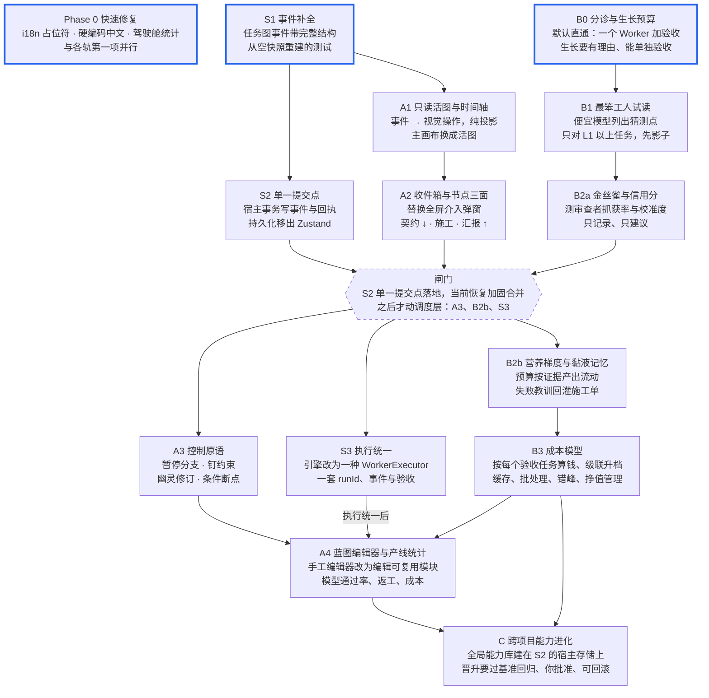
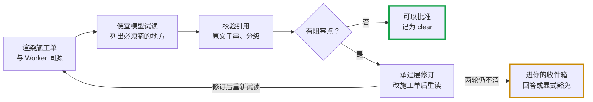

# SlimeMold 活图与自调优工厂：实施计划

> 版本：2026-10-08（建议稿）
>
> 状态：尚未排入开发顺序；近期开发顺序仍以[下一阶段计划](NEXT_PHASE_PLAN.md)为准，本计划的条目经确认后再并入。
>
> 来源：与 Claude 讨论整理，导出自 Claude Doc；原文的两张交互图在此改写为 Mermaid。

## 目标与范围

本计划做两件事：把专业视图的中心换成会生长的"活图"，再给工厂装上能自己调优的闭环。第一批交付 Phase 0 快速修复、S1 事件补全、B0 分诊与生长预算，三者互不依赖，可以并行；A1 和 B1 紧随其后。

要交付的：

- 结构轨 S：事件流补全到能重建任务图，执行事实收进单一提交点，两套执行路径合一。
- 界面轨 A：活图成为专业视图主画布，配时间轴回放、收件箱、节点三面、局部暂停等控制原语，原手工编辑器改成蓝图编辑器。
- 机制轨 B：分诊与生长预算、最笨工人试读、金丝雀缺陷、信用分、营养梯度、黏液记忆、成本模型，串成"输入把关 → 审查校准 → 预算按证据分配 → 失败回灌"的闭环，并保证小任务不被过度组织。
- 能力进化 C：经过验证的能力在项目之间沉淀复用，项目事实永不跨项目。

不做的：

- 不改执行事实源。活图和收件箱都是投影，状态迁移仍由控制面命令和 DomainEvent 决定。
- S2 单一提交点落地前不改调度层；A3、B2b、S3 排在后面。
- 不新增颜色语义，不做装饰性动画和徽章。
- 点子池里的其余点子（休眠、孢子、时间线分叉等）本计划不排期，见末节。

依据：2026-10-07 的界面评审和头脑风暴，原文在 Claude 项目资料里（`claude/ui-interaction-proposal.md`、`claude/brainstorm-ideas.md`），不在仓库内。

## 现状与约束

后端已经有活图需要的大部分数据，界面还没有用上；同时 Phase 2 的恢复与清理加固仍在进行，调度层这段时间不宜并行改动。

| 模块 | 现状 | 对本计划的意义 |
| --- | --- | --- |
| 专业视图主画布 | `src/canvas/WorkflowEditor.tsx` 是手工连线编辑器，不引用 TaskGraph 或 projectControl | A1 把主画布换成活图 |
| 执行图 | `TaskGraphDAGView` 只在 `OrchestratorPanel`（左侧栏，默认 248px）里，是卡片列表加文本边 | 数据源 `taskGraphProjection.ts` 可直接复用 |
| 事件与回放 | `replayDomainEvents`（`src/domain/contracts.ts`）能重放 Run/Task 状态，但 TaskGraphProposed 只带 taskIds，重建不出任务图结构 | S1 补全事件后 A1 才能纯投影；委派、子任务事件也要补 |
| 层级 | `hierarchy.ts` 定义 11 个角色；`delegation.ts` 有委派图但不产生持久事件 | 活图分层布局的依据 |
| 可信度 | `progressSummary.ts` 已有 `completionBasis`、`staleAt` | 实心 / 空心 / 虚线编码的数据源 |
| 人工介入 | `InterventionModal` 是全屏阻塞弹窗；暂停只有 run 级和项目级 | A2、A3 替换 |
| 施工单 | Codex 与 Antigravity 执行器各自拼施工单（`buildCodexWorkerPrompt`、`promptFor`），契约部分重复 | B1 先抽出单一渲染函数 |
| 路由与成本 | `routerScoring.ts`（成本、成功率、档位权重）、`agentEconomics.ts` | B2 信用分、B3 成本模型、A4 产线统计的底座 |

约束：

- 当前分支 `phase2/worker-recovery-cleanup-cas` 仍在加固恢复与清理（最近提交在 2026-10-07）。`src/domain/workerQueue.ts` 和恢复相关文件是热区，A3、B2b 的调度改动等这条线合并、且 S2 落地后再开工。
- 仓库同时有其他 Agent 在提交：只提交自己改的文件（`git commit -o`），不用 `git add -A`，不自动 push 或 merge。
- 浏览器预览和 Tauri 桌面端都不能白屏；未取得独立评审通过前，交付保持 unverified，和现有流程一致。

## 设计原则

八条原则贯穿所有阶段，评审时逐条对照。

1. 动效即事件。活图上每一次变化都对应一条 DomainEvent；实时和回放共用同一个投影函数；没有事件就没有动画。
2. 视图不是事实源。图上的操作先变成领域命令（暂停、钉约束、PlanRevision），由控制面校验、落事件后再投影回来，与产品哲学文档第 7 节一致。
3. 沿用颜色语义。蓝 = 可操作或进行中，绿 = 真实成功，黄 = 待确认，红 = 真实失败，灰 = 未开始；方向和可信度靠形状、填充和动效表达。
4. 证据优先。中层只上送有宿主证据的结论；未验证的结论显示为空心，不进顶层摘要。
5. 先影子，后闸门。新机制先以只记录、不拦截的影子模式跑一段，数据证明有效后再升级为闸门。
6. 失败保留。缩回、疤痕、塑缩都只改变显示，不删除现场和 worktree。
7. 按需生长。默认最小组织；每多长一层或一个节点，都要有理由、有预算、能单独验收；由下层用证据申请，规划层不预先铺开。
8. 沟通对齐。人与 AI 是同事和上下级的关系，对齐的是沟通：向下，主控帮用户把需求说清楚，只问会改变架构、成本或验收的问题；向上，汇报准确、简洁、能追到证据，把每个决定准备到能快速拍板。人和模型遵守同一套事实规则（结论要证据，决定留出处），目标与最终决定权在人。

## 路线总览

三条轨道并行推进：结构轨 S 先补地基，界面轨 A 让活图上舞台，机制轨 B 让工厂自己调优。第一批是 Phase 0、S1 和 B0；A3、B2b、S3 要动调度层，等 S2 单一提交点落地后开工。

**路线图**：三条轨道并行，调度层改动等单一提交点落地之后。粗蓝框 = 第一批交付（Phase 0、S1、B0），虚线六边形 = 闸门。



A1 等 S1 补全事件后做纯投影；A4 的蓝图编辑器等 S3 统一执行，产线统计用 B2、B3 的数据；C 建在 S2 的宿主存储之上，最后做。闸门之前的工作都不碰调度层。

## Phase 0 快速修复

Phase 0 只修界面上看得见的错误，不碰控制面，规模小，可以和 A1、B1 同时进行。

- [ ] 修正 7 个 locale 文件里的 17 处单花括号占位符，改为 i18next 默认的 `{{name}}`（`statusbar.xml`、`nodepalette.xml`、`inspector.xml` 的中英文版，以及英文 `settings.xml`）。
- [ ] 扩展 `scripts/check-i18n.ts`：拒绝单花括号占位符；同一个 key 在各语言里的占位符集合必须一致。现在它只校验 key 是否对齐。
- [ ] 把专业视图入口文件里的中文硬编码移进 i18n。粗略统计（不含注释）：`WorkflowEditor.tsx` 34 行、`LeftSidebar.tsx` 18、`App.tsx` 10、`OrchestratorPanel.tsx` 9、`Inspector.tsx` 4、`TopBar.tsx` 3、`StatusBar.tsx` 1；默认名"未命名工作流"在 `workflowLifecycleState.ts` 和 `workflowSerialize.ts`。
- [ ] 轻量驾驶舱的统计卡（`BeginnerExperience.tsx` 的工作流数、节点数）换成"待你决定"和"已验证任务 x / y"，数据取自会话未决问题和 `progressSummary`。

验收：中英文下状态栏都显示真实数字；`npm run i18n:check` 对单花括号和占位符不一致返回非零；上述文件在英文界面下不再出现中文字面量；驾驶舱不再展示节点数；`npm run test`、`npm run build` 通过。

## S 结构收敛

这个项目最大的架构问题不在代码质量，而在"事实存在太多地方、没有单一提交点"：一次 Worker 状态迁移要依次写好几处，每个崩溃窗口都要一条恢复路径。复杂度来自存储拓扑，而不是业务本身。S 轨先补地基，调度层的新功能排在它之后。

| 问题 | 证据 |
| --- | --- |
| 事实分散在多处 | 执行状态落在 `project.json` 快照、`events/events.jsonl`、`snapshots/project-state.json`、`runs/side-effects.json`、`runs/recovery-decisions.json`、`evidence/*.jsonl`；引擎另有 `runs/checkpoints.json` 和每次运行的 `events.jsonl` |
| 提交路径经过界面状态 | `workerRunTransitionPersistence.ts`：记事件 → 改 Zustand → 读副作用文件 → 存 ProjectFile，顺序写多处，中间任何一步崩溃都要单独恢复 |
| 修补螺旋 | `projectControl` 里 39 个 `worker*` 文件共 9,244 行，占该目录 58%；9 月以来 709 次提交中 239 次与恢复、清理、CAS、修补相关，258 次标为 unverified；提交记录里已经出现"第五轮恢复边界修复" |
| 事件流不完整 | `TaskGraphProposed` 只带 taskIds；项目自己的架构审查（2026-09-02）已指出事件流不能独立重建完整 ProjectControl，一个月后仍是如此 |
| 中心化的 store | `workflowStore.ts` 被 50 个文件引用、自己引用 42 个；`engine`、`nodes`、`agents`、`plugins` 直接依赖它；9 月以来改动 47 次，仅次于 `App.tsx` 的 51 次 |
| 两套执行系统 | 静态工作流引擎（engine、nodes、orchestrator 约 1.1 万行，数字 runId、runEvents）与 Worker 队列（UUID runId、attempt、worktree）并存，`OrchestratorPanel` 仍可调用 `runOrchestration()` |

健康的部分也要记下：分层整体守得住（1,216 条内部依赖里只有 32 条反向、3 个小环），有 1,405 个测试用例，产品哲学和事实边界清楚。问题集中在存储拓扑和两个中心对象上。

- [ ] S1 事件补全：任务图的提出与修订事件带完整结构（或内容寻址的不可变版本引用），加"从空快照加全事件流重建"的测试。规模：小到中。
- [ ] S2 单一提交点：执行事实的持久化收进 Tauri 宿主，一个事务写完事件、副作用意图与回执、恢复决定；快照和其余文件都变成可重建的投影。候选是 SQLite（WAL 模式），先做原型和崩溃注入测试再定。持久化同时移出 Zustand，store 只做读模型和界面状态。规模：大。
- [ ] S3 执行统一：静态工作流引擎改为一种 `WorkerExecutor`，与 Codex、Antigravity 并列，共用队列、租约、证据和验收；或者冻结为演示功能。与 A4 一起做。规模：中。
- [ ] 当前分支的恢复与清理工作先收口到稳定点并合并；之后不再新增 fence 类补丁，等 S2 从根上消除崩溃窗口。

本节覆盖 TypeScript 侧与持久化路径；Rust 宿主只看了存储与锁的部分。

## B0 分诊与生长预算

默认组织是最小的：一个 Worker 加宿主验收。每多长一层、多一个节点，都要有理由、要花预算、要能单独验收；写一个 helloworld.py 永远不会长出讨论组。规模：中。

分诊在规划之前做，由 Boundary Contract 的范围、接口、副作用和风险推导，不靠模型自由发挥：

| 等级 | 适用情况 | 组织 | 仪式 |
| --- | --- | --- | --- |
| L0 直通 | 改动在一个文件或一个函数内、不跨模块接口、可逆、无外部副作用 | 1 个 Worker + 宿主验收 | 不开讨论、不试读、不设组长 |
| L1 单组 | 一个模块内、有多个能单独验收的子任务 | 组长 + Worker + 独立审查 | B1 试读、审查 |
| L2 多组 | 跨模块接口、高风险、长时间或预算大 | 完整层级 | 方案评审、接口契约、全部闸门 |

生长规则：

- 只有四种合法理由：上下文装不下；子任务能单独验收且范围不重叠；能并行且确实省时间；风险要求独立审查或不同能力。"导入包""定义函数"这种不能单独验收的切分直接拒绝。
- 自下而上：先按低一级执行，下层拿证据（上下文溢出、连续失败、歧义反馈）申请生长，规划层不预先铺开。
- 生长预算：规划、协调、审查花费占总成本的比例设上限；超过时把"拆分方案"与"直通方案"的预计成本放进收件箱，由你选。
- 反向收缩：只有一个子节点的管理层自动折叠，空闲的管理节点退场。
- 活图上每个节点都显示"为什么长出来"，过度生长看得见、可追责。

| 文件 | 改动 |
| --- | --- |
| `src/projectControl/triage.ts`（新） | 由 Boundary Contract 推导组织等级 |
| `src/projectControl/growthPolicy.ts`（新） | 生长理由校验、预算上限、折叠规则 |
| `src/projectControl/projectPlanning.ts`、`taskGraph.ts` | 规划按等级生成组织，L0 不生成中间层 |
| `src/projectControl/hierarchy.ts` | 角色可跳级，管理节点可折叠 |

验收：

- [ ] 基准用例：helloworld.py 走 L0，零管理节点、零讨论、不试读，模型调用次数不超过固定上限。
- [ ] 不能单独验收的子任务被拒绝，并给出原因。
- [ ] 协调开销超过上限时不自动生长，而是进收件箱让你选。
- [ ] 一组小任务基准的直通率和协调开销占比进入产线统计，回归时可以对比。

## B1 最笨工人试读

任务图批准前，让最便宜的模型逐份读施工单，只列出它不得不猜的地方。先用影子模式跑，等数据证明"猜测点"能预测返工，再升级为批准闸门。只对 B0 判为 L1 及以上的任务试读，直通任务跳过。规模：中。不碰 `workerQueue`，所以不用等调度层解冻。

**B1 流程**：施工单先让最便宜的模型读懂，读不懂就修订，两轮仍不清才找你。图为闸门模式；影子模式只记录猜测点，不拦截批准。



猜测点必须逐字引用施工单原文才算数；试读本身失败时记为 unknown，既不拦截，也不当作 clear。

数据与事件：

- `WorkOrderPreflight`：taskId、graphVersion、workOrderDigest、模型、verdict（clear / ambiguous / unknown）、猜测点列表、成本、模式（shadow / gate）。
- 猜测点：quote（施工单原文）、question、consequence、severity（blocking / minor）、options。字段和现有 `FeedbackRequest` 对齐，A2 的收件箱可以统一渲染。
- 事件 `WorkOrderPreflightCompleted`；用户豁免时记 `WorkOrderPreflightWaived`，并引用一条 Decision。
- 任务被修订后 digest 变化，旧试读自动作废。

| 文件 | 改动 |
| --- | --- |
| `src/projectControl/workOrder.ts`（新） | `renderTaskContract(task)` 与 `workOrderDigest()`，两个执行器和试读共用，保证试读读到的就是 Worker 拿到的 |
| `src/dev/codexWorkerExecutor.ts`、`src/dev/antigravityWorkerExecutor.ts` | 删除重复的契约拼接，只保留各自的运行时头部和边界说明 |
| `src/projectControl/workOrderPreflight.ts`（新） | 提示词、JSON 解析、quote 子串校验、blocking 判定 |
| `src/projectControl/commands.ts` | 新增 `recordWorkOrderPreflightCommand`；闸门模式下 `approveTaskGraphCommand` 检查最新试读 |
| `src/projectControl/types.ts`、`src/domain/contracts.ts`、`projectControlConsistency.ts` | 类型、事件与一致性校验里的事件白名单 |
| `src/agents/agentRouter.ts` | 复用 `resolveAgentScored` 选 light 档最便宜的可用模型 |
| `src/components/OrchestratorPanel.tsx` | 任务卡片显示猜测点数，展开后高亮被引用的句子；A2 之后迁到"契约"面 |

试读提示词的核心：

```text
你稍后要独立完成下面这份施工单。现在不要写代码，也不要给方案。
逐条列出你必须靠猜才能动手的地方，每条给出：
- quote：施工单里引起猜测的原文（逐字复制）
- question：你需要谁回答什么
- consequence：猜错会影响验收、接口、范围，还是只影响风格
没有需要猜的地方就返回空列表。只输出 JSON。
```

指标与假设验证：

- 每份施工单的 blocking 猜测点数（均值、P90）、首轮即 clear 的比例、清零所需轮数、每次试读成本。
- 影子模式下，比较"有 blocking 猜测点"和"clear"两组任务在运行期的 `TaskFeedbackRequested` 次数与评审打回率。两组没有明显差异就不升级为闸门。

验收：

- [ ] 一致性测试：两个执行器的 prompt 都包含 `renderTaskContract` 的完整输出。
- [ ] quote 不是施工单子串的猜测点被丢弃，有单测。
- [ ] 影子模式：批准流程不受影响，事件被记录，面板显示猜测点。
- [ ] 闸门模式：有未处理的 blocking 猜测点时 `approveTaskGraphCommand` 拒绝并列出原因；豁免后通过，并留下 Decision。
- [ ] 试读失败（模型不可用、JSON 不合法）记为 unknown：不阻止批准，也不当作 clear。

后续（B1b）：调度层解冻后，在派发前再读一次，那时依赖产物已经确定。

## A1 只读活图与时间轴

A1 把专业视图的主画布换成活图：从事件流投影出带层级的运行图，配一条可以拖动回放的时间轴。全程只读，不改任何事实。规模：大，工作量主要在投影和渲染。

核心是一个纯函数 `graphGrowthProjection(events, uptoSeq)`：输入事件与截止序号，输出节点、边、流动、疤痕、胶囊。实时视图就是"重放到最后一条"，所以两者不可能不一致。第一版层级用已有数据：会话 → 架构模块（`ArchitectureModule`，任务带 `moduleId`）→ 任务 → 尝试；委派和子任务事件补上之后，再显示部门与组长层。

前置条件：S1 完成前，结构取自 ProjectControl 快照里的任务图，状态取自事件流；S1 之后改为纯事件投影。

| 事件 | 活图上的变化 |
| --- | --- |
| `TaskGraphProposed`、`TaskGraphRevisionCreated`、`DepartmentWorkPackageDispatched` | 节点从父节点长出，边先于点出现 |
| `TaskQueued` | 灰色排队态 |
| `TaskStarted` | 蓝色呼吸，只有持有租约的节点会动 |
| `TaskFeedbackRequested`、`TaskBlocked` | 黄色，收件箱计数加一 |
| `TaskSucceeded`（有宿主证据） | 实心绿色，摘要沿边上行，边的累计流量加一（线变粗） |
| `TaskFailed` | 红色；下一次尝试开始时，旧尝试缩成疤痕 |
| `TaskAttemptMarkedUnknown` | 虚线轮廓 |
| 每次尝试结束 | 节点外加一圈年轮：失败红、成功绿 |
| 子树全部 evidence-backed（`progressSummary`） | 塑缩成胶囊，可展开 |

年轮第一版按"尝试"计，用现有事件就能算。要区分"评审打回"和"执行失败"，需要给 Acceptance 记录加原因字段。

布局与渲染：

- 增量稳定布局：已有节点坐标不动，新节点插在父节点下方的空位，位置按 nodeId 缓存。需要新增一个布局依赖（d3-hierarchy 或 elkjs，见待决问题）。
- 继续用 `@xyflow/react` 渲染近景；节点规模上去后，远景再评估 canvas 渲染。
- 语义缩放：远看是模块胶囊和健康度，近看是任务、尝试和证据数。
- 时间轴按事件序号排列，标出决策、失败和用户干预。回放态顶部显示"正在查看历史 · 回到实时"，所有命令入口禁用。
- 主画布默认显示活图；`WorkflowEditor` 暂时作为第二个标签保留，A4 再改成蓝图编辑器。

| 文件 | 改动 |
| --- | --- |
| `src/projectControl/graphGrowthProjection.ts`（新） | 事件 → 活图状态，纯函数，可快照测试 |
| `src/canvas/LivingGraph.tsx`（新） | 渲染、语义缩放、呼吸、流动、年轮 |
| `src/components/TaskGrowthTimeline.tsx`（新） | 时间轴、事件密度、标记、回放态 |
| `src/App.tsx` | 主画布切换：活图默认，`WorkflowEditor` 作为第二标签 |
| `src/domain/eventStore.ts`、`src/projectControl/eventBuffer.ts` | 从 `.slimemold/events/events.jsonl` 读历史，订阅新事件 |
| `package.json` | 布局依赖 |

验收：

- [ ] 同一事件序列、同一截止序号得到同一个活图状态；实时视图与"重放到最后一条"完全一致。
- [ ] 每一种视觉变化都能追到触发它的事件 id（点节点可见）。
- [ ] 新增节点时，已有节点坐标不变（布局稳定性测试）。
- [ ] 回放态下所有命令入口禁用，并有明显标识。
- [ ] 从项目会话进入专业视图，看到的是当前项目的活图，不是空白画布。
- [ ] 浏览器预览与 Tauri 不白屏；用一个合成的大事件流做性能冒烟。

## A2 收件箱与节点三面

A2 用收件箱替换全屏弹窗，用"节点三面"替换 Inspector 和编排面板里的文本框修订。写操作只调用现有命令，不新增执行路径。规模：中。

收件箱：

- 来源都已存在：`TaskFeedbackRequested`、会话的未决问题（`OpenQuestion`）、待批准的 Brief / 架构 / 任务图、B1 的 blocking 猜测点、现有的 retry / skip / cleanup 确认、静态工作流的 `node.intervene`。
- 每条写清：卡住的下游任务数、等待时长、谁先尝试过解决、选项与推荐、在活图上的位置（点击飞过去）。
- 按阻塞影响排序：卡住的任务数 × 等待时长；同类问题可以批量回答。
- 介入请求不再弹全屏遮罩，只在用户主动打开时展开。

节点三面（右侧面板）：

- 契约 ↓：施工单原文（复用 B1 的 `renderTaskContract`）、验收标准、允许范围、被排除的上下文、猜测点高亮、收到的歧义反馈次数。
- 施工：尝试列表（即年轮）、模型、token 与成本、worktree、diff 摘要、日志入口。
- 汇报 ↑：往上送的结论和证据引用、`completionBasis`、`staleAt`；多层委派落地后，再显示被中层过滤掉的内容和原因。
- 修订：编排面板里用文本框改 title / dependsOn 的做法，改成在"契约"面编辑并生成任务图修订草案；带影响面的幽灵修订在 A3。

| 文件 | 改动 |
| --- | --- |
| `src/projectControl/inboxProjection.ts`（新） | 把各来源投影成统一条目，纯函数 |
| `src/components/InboxPanel.tsx`（新） | 条目列表、排序、批量回答 |
| `src/components/NodeFaces.tsx`（新） | 三面面板，活图选中节点时取代 Inspector |
| `src/components/InterventionModal.tsx`、`src/engine/intervention.ts` | 介入请求改为收件箱条目 |
| `src/components/OrchestratorPanel.tsx` | 文本框修订和恢复按钮迁出 |
| `src/components/LeftSidebar.tsx` | 左侧栏增加收件箱入口，有待决事项时默认打开 |

验收：

- [ ] 同时有多个待决事项时不出现全屏遮罩，其它分支继续运行。
- [ ] 每条条目都能跳到活图上的对应节点；回答后条目消失，对应事件落盘。
- [ ] 收件箱计数与活图上的黄色节点数一致（同源投影测试）。
- [ ] 三面里的施工单文本与 Worker 实际收到的一致。
- [ ] 现有 retry / skip / approve / cleanup 操作在收件箱里可用，行为不变，有回归测试。

## A3 控制原语

A3 把"局部暂停与引导"做成四个控制面命令，先落事件，再由调度和投影响应。这是第一处改调度层的地方，必须等 S2 单一提交点落地、恢复与清理加固合并后开工。规模：大。

| 原语 | 命令与事件 | 调度与投影 |
| --- | --- | --- |
| 暂停分支 | `placeHold(scope, mode)` → `ScopeHoldPlaced`；`releaseHold` → `ScopeHoldReleased`；mode 为 drain（当前步后）或 stop（立即） | `runnableTaskIds()` 过滤被 hold 覆盖的任务；`assertBeforeExternalWork` 派发前再查一次；stop 取消在途 attempt，没有回执的副作用标 unknown；活图显示斜线罩和"排空中 n" |
| 钉约束 | `pinConstraint(scope, text)` 生成 Decision 提案，批准后记 `DecisionApproved` | 算出受影响任务，其 ContextPack 的 `contextVersion` 递增、旧版作废；下一次 attempt 拿到新约束 |
| 幽灵修订 | 暂停态的结构编辑生成任务图修订草案，应用时走现有 `reviseTaskGraphCommand` | 草案以虚线叠在活图上，旁边列出作废的 attempt、重发的契约和预算变化；"应用并恢复" = 修订加释放 hold |
| 条件断点 | `setBreakpoint(rule)`：合并前、同一任务被打回 N 次、预算超过阈值、请求范围外上下文 | 规则命中时自动记 `ScopeHoldPlaced`（原因为 breakpoint），并进收件箱 |

规则：

- hold 的范围只用稳定 id 表达（moduleId、taskId 集合、委派子树），不用画布选区。
- 重启后 hold 依然有效（由事件重放恢复），不会因重启自动解除。
- stop 模式遵守现有恢复语义：开新 attempt，旧现场保留，不覆盖。
- 断点规则属于项目配置，修改需要用户确认。

| 文件 | 改动 |
| --- | --- |
| `src/projectControl/hold.ts`（新） | hold 的命令、事件与作用范围计算 |
| `src/domain/workerQueue.ts` | `runnableTaskIds()` 与派发栅栏读取 hold |
| `src/projectControl/commands.ts` | `placeHold`、`releaseHold`、`pinConstraint`、`setBreakpoint` |
| `src/projectControl/contextPack.ts`、`protocol.ts` | 约束传播与 `contextVersion` 递增 |
| `src/projectControl/breakpoints.ts`（新） | 断点规则求值，订阅事件 |
| `src/canvas/LivingGraph.tsx` | 右键菜单、斜线罩、幽灵层、影响面浮层 |

验收：

- [ ] 暂停一个分支后，兄弟分支照常派发；被暂停分支不再出现新的 `TaskStarted`。
- [ ] drain 模式下在途 attempt 正常结束；stop 模式下在途 attempt 被取消，没有回执的副作用标 unknown。
- [ ] 重启应用后 hold 仍然生效。
- [ ] 钉约束后，受影响任务下一次 attempt 的 ContextPack 含新约束、版本号递增；未受影响任务不变。
- [ ] 幽灵修订在"应用"前不产生任何事件，取消后不留痕迹。
- [ ] 断点命中时自动暂停，并在收件箱出现条目。

## B2 自调优闭环

B2 让审查和预算由数据驱动：先测审查者靠不靠得住，再给每个模型算信用分，最后让预算和失败教训按证据流动。B2a 只记录、只建议，不改调度；B2b 改调度和 ContextPack，排在闸门之后。规模：B2a 中，B2b 大。

B2a 金丝雀缺陷与信用分：

- 金丝雀：在独立评审流程里（`hierarchy.ts` 的 assurance 层、`releaseGate.ts` 的回执），按比例混入已知有缺陷的变体。变体由脚本对已验收的 diff 做可控变异：删一个边界判断、改一个比较符、去掉一个测试断言。评审结果与已知答案比对，得出每个审查模型的抓获率。
- 金丝雀永远不进入真实代码：只在独立的只读副本上评审，结果单独记账。
- 信用分：按"模型 × 任务类别"统计通过率、返工轮数、自报信心与实际结果的校准度（例如 Brier 分数），审查模型另计抓获率。扩展 `experienceStore.ts` 的 `AgentMetric` 和 `routerScoring.ts` 的 `successByAgent`。
- 信用分先只用于展示和建议（"这个模型在 UI 任务上返工率高，建议加一轮审查"），不自动改路由；信用高的模型也保留随机抽查，防止评估漂移。

B2b 营养梯度与黏液记忆：

- 营养梯度：在用户批准的总预算内，按分支"每个 token 换来的已验证证据"重新分配并发数和模型档位。产出低的分支逐步降配，降到下限后进收件箱，由用户决定是否收缩。每次分配记 `BudgetReallocated` 事件，活图的边宽直接显示分配结果。
- 黏液记忆：失败的 attempt 结束时提炼一条负面知识（试过什么、为什么失败、证据引用），写进该任务和兄弟任务后续 ContextPack 的固定字段。每条必须引用失败证据；用户可以在节点三面里删除或改写。

| 文件 | 改动 |
| --- | --- |
| `src/projectControl/canary.ts`（新） | 变异生成、混入比例、抓获率统计 |
| `src/projectControl/releaseGate.ts`、`hierarchy.ts` | 审查回执带金丝雀标记，结果单独记账 |
| `src/agents/experienceStore.ts`、`routerScoring.ts` | 模型 × 任务类别的信用分与校准度 |
| `src/projectControl/budget.ts` | 营养梯度分配与 `BudgetReallocated` 事件 |
| `src/projectControl/contextPack.ts` | 黏液记忆字段与来源校验 |

验收：

- [ ] 金丝雀变体不会进入任何真实 worktree 或分支（隔离测试）。
- [ ] 每个审查模型都有抓获率和样本数；样本不足时显示"数据不足"，而不是一个数字。
- [ ] 信用分能追溯到具体任务和评审记录。
- [ ] 预算重新分配不超过用户批准的总额，每次分配都有事件和理由。
- [ ] 没有证据引用的黏液记忆条目被拒绝。
- [ ] 用同一批任务做开关 B2b 的对照，比较返工轮数和成本。

## B3 成本模型

B3 把成本的记账单位从"每次调用"改成"每个通过验收的任务"，再按这个口径调路由、缓存和时段。指标部分随时可以做；改调度的部分（批处理、错峰排产）排在闸门之后。规模：中。

记账与路由：期望成本按"模型 × 任务类别"从验收记录统计，c 是每次尝试成本，r 是每次审查成本，p 是通过率。

$$
E[C] = \frac{c + r}{p}
$$

- 示意：便宜模型 c=1、p=0.4，中档模型 c=3、p=0.9，审查都是 r=1，前者 5.0、后者约 4.4。单价便宜不等于每个验收任务便宜。
- `routerScoring.ts` 的线性加权（成本 0.35、成功率 0.35、档位 0.3）改为在满足能力与风险约束后最小化期望成本。
- 级联：先用便宜模型，失败一次就升档；同一模型重试常常犯同样的错，升档阈值由自己的数据定。

上下文与缓存：

- 施工单固定前缀顺序：项目约定 → 模块契约 → 本任务，兄弟任务和重试才能命中缓存。
- 缓存命中价按厂商取值：DeepSeek flash 高峰时段命中 $0.006/M、未命中 $0.30/M，约 2%（[DeepSeek 定价](https://api-docs.deepseek.com/quick_start/pricing)）；Claude 读缓存为基础输入价的 0.1 倍，部分模型更低（[Claude 定价](https://platform.claude.com/docs/en/about-claude/pricing)）。`agentEconomics.ts` 现在统一按 10% 计，要改成按厂商取值，并记录每次调用的命中率。

时段（价格查阅于 2026-10-08）：

- 不急的工作（试读、金丝雀审查、摘要重建、夜间分支）可走批处理接口：Claude 与 OpenAI 都是五折，OpenAI 承诺 24 小时内完成（[OpenAI Batch API](https://developers.openai.com/api/docs/guides/batch)）。
- DeepSeek 非高峰时段半价；高峰为工作日 UTC 01:00–04:00 与 06:00–10:00，即新加坡时间 09:00–12:00 和 14:00–18:00。
- 是否允许推迟、最多推迟多久，由你在项目设置里决定。

挣值管理：每个任务带预算，只有通过宿主验收才计入已挣值；每个分支算 CPI = 已挣值 ÷ 实际花费，并给出完工成本预测；CPI 持续偏低的分支进收件箱。B2b 的营养梯度和"项目天气预报"都用这套口径。

硬刹车：单次尝试设 token 上限，单任务设重试上限；花钱速度异常时触发 A3 的条件断点；验收结果按 git tree hash 缓存，同一棵代码树不重跑测试。

| 文件 | 改动 |
| --- | --- |
| `src/projectControl/costModel.ts`（新） | 期望成本、挣值、CPI 计算，纯函数 |
| `src/agents/routerScoring.ts`、`agentRouter.ts` | 按期望成本排序，级联升档 |
| `src/agents/agentEconomics.ts` | 缓存价按厂商取值，记录命中率 |
| `src/projectControl/workOrder.ts` | 施工单固定前缀顺序，与 B1 共用 |
| `src/projectControl/budget.ts` | 任务预算与挣值记账 |
| `src/dev/workerAcceptance.ts` | 按 tree hash 缓存验收结果 |

验收：

- [ ] 期望成本能从验收记录重算，样本不足时显示"数据不足"。
- [ ] 路由先在影子模式下给出"按期望成本会选谁"，和实际选择对比一段时间再切换。
- [ ] 同一施工单的重试，缓存命中率高于首次调用，以产线统计为准。
- [ ] 推迟到便宜时段的任务不超过你设定的延迟上限。
- [ ] 每个分支都有 CPI 和完工成本预测，只按已验收任务计挣值。

## A4 蓝图编辑器与产线统计

A4 给原来的手工编辑器一个新身份：编辑可复用的模块（蓝图）；同时加一张产线统计，让模型分工由数据来调。规模：中。

蓝图编辑器：

- `WorkflowEditor` 从主画布退到"蓝图"标签，编辑对象从"当前运行的工作流"变成"可复用模块"，对应产品哲学里的 Static / Published Graph（`moduleId@version`）。
- 在活图上双击模块节点，进入它引用的蓝图；运行时展开的节点保留 sourceGraphId / sourceNodeId 溯源，不能反向改蓝图。
- 蓝图编辑是 Draft，发布后才能被引用；已发布版本不可变，修改生成新版本。
- 第一张蓝图：你自己的"规划 → 施工 → 对抗审查 → 回填"循环，用现有的 `*.workflow.json` 格式。

产线统计：

- 按模型：通过率、返工轮数、审查抓获率（来自 B2a）、每个已验收任务的成本和耗时。
- 按环节：规划、施工、审查各自的吞吐和排队长度，标出瓶颈并给出建议（加一个审查员，或换更快的审查模型），不自动调整。
- 按施工单：B1 的猜测点数与运行期反馈次数的关系。
- 数据只读，来自 `experienceStore.ts`、`agentEconomics.ts` 和事件流；样本不足时显示"数据不足"。

| 文件 | 改动 |
| --- | --- |
| `src/canvas/WorkflowEditor.tsx`、`src/canvas/SubgraphEditor.tsx` | 编辑对象改为蓝图，增加发布与版本 |
| `src/io/workflowIO.ts` | 蓝图读写与版本号 |
| `src/projectControl/productionStats.ts`（新） | 统计投影，纯函数 |
| `src/components/ProductionStats.tsx`（新） | 产线统计页 |

验收：

- [ ] 在活图里双击模块能打开对应蓝图，返回后活图状态不变。
- [ ] 已发布的蓝图版本不可修改，修改生成新版本。
- [ ] 产线统计里的每个数字都能点开来源记录。
- [ ] 能指出当前瓶颈环节并给出建议，不自动改配置。

## C 跨项目能力进化

C 让经过验证的能力在项目之间沉淀和复用：项目事实永不跨项目，只有抽象后、过了基准回归、经你批准的能力才进入全局库。它建在 S2 的宿主存储之上，排在最后。规模：大。

现状：经验库和模型指标存在 WebView 的 localStorage，按项目隔离，只保留最近 100 条，而且只从旧工作流引擎的运行里记录（`wfId`、数字 `runId`），Worker 运行没有进入经验库。ADR-SM-020 已经规定记忆不能覆盖事实和授权、需要用户审核，本节在这个边界内设计。

| 层 | 内容 | 能否跨项目 |
| --- | --- | --- |
| 项目事实 | 决定、任务图、代码、证据 | 永不 |
| 项目经验 | 带证据的成败记录、负面知识、猜测点 | 抽象并去除代码与标识符后，可申请晋升 |
| 全局能力 | 路由统计、施工单模板、蓝图、组织配置 | 有版本、可回滚，按适用条件检索 |

晋升流程：

1. 候选：项目经验里带证据、重复出现的模式。
2. 抽象：去掉代码、路径和客户信息，只保留可复用的规则或模板。
3. 回归：在固定基准任务上跑，结果不能比现有版本差；另留一组从不参与进化的基准任务，专门测是否真的变强。
4. 批准：由你批准后进入全局库，记录来源项目与证据。
5. 回滚：任何版本都能撤回，撤回本身也是一条事件。

进化规则：

- 先后顺序：先路由（数值化、风险低、易回滚），再施工单模板（以 B1 猜测点下降为适应度），再蓝图与组织配置，提示词最后。
- 防古德哈特：金丝雀缺陷常驻；验收标准在执行前固定；跟踪测试强度，不只看通过率。
- 自我修剪：每项能力带适用条件（技术栈、任务类型）和分情境的成功率；在新项目失败就收窄适用范围，长期不用或成功率低的能力自动退场。
- 隐私：一个项目可以整体设为"不参与能力共享"，适合客户项目。

| 文件 | 改动 |
| --- | --- |
| `src-tauri/src/storage/`（新增能力库） | 全局能力库放在 app data，用 S2 的事务存储 |
| `src/agents/experienceStore.ts` | 迁出 localStorage；改从 Worker 运行的验收记录生成经验 |
| `src/projectControl/capabilityLibrary.ts`（新） | 候选、抽象、晋升、回滚 |
| `src/projectControl/benchmarks/`（新） | 基准任务集与留出集 |

验收：

- [ ] 任何全局能力都能追到来源项目、证据和批准记录。
- [ ] 晋升前基准回归不通过时自动拒绝。
- [ ] 一个项目可以整体设为不参与能力共享。
- [ ] 能力在新项目里失败后，适用范围收窄，并有事件记录。
- [ ] 清空 WebView 存储不会丢失任何经验或能力。

## 指标、验证与执行纪律

每个阶段都按"测试、构建、真实宿主回读、独立评审"收口；整体效果用下面这组可以从事件重算的指标衡量。

| 指标 | 衡量什么 | 来源 | 从哪个阶段开始 |
| --- | --- | --- | --- |
| 每份施工单的 blocking 猜测点 | 施工单是否无歧义 | `WorkOrderPreflightCompleted` | B1 |
| 每个任务的运行期歧义反馈 | 歧义是否真的变少 | `TaskFeedbackRequested` | B1 |
| 首次尝试通过率、平均返工轮数 | 施工质量 | Task 生命周期事件 | 现在就能算 |
| 审查抓获率 | 审查者是否可靠 | 金丝雀记账 | B2a |
| 可信覆盖率 | 顶层摘要里有多少结论有证据 | `progressSummary` | A1 |
| 每个已验收任务的成本 | 性价比 | `agentEconomics.ts` | 现在就能算 |
| 直通率 | 小任务有没有被过度组织 | B0 分诊记录 | B0 |
| 协调开销占比 | 规划、协调、审查花的钱占总成本多少 | `agentEconomics.ts` 按角色拆分 | B0 |
| 决策准备度 | 待决事项是否准备到不用翻日志就能拍板 | 收件箱：拍板用时、打开原始日志的比例 | A2 |
| 分支 CPI 与完工成本预测 | 花费是否跟得上已验收的进度 | 预算与验收记录 | B3 |
| 缓存命中率 | 上下文有没有被重复付费 | 厂商返回的用量 | B3 |
| 全局能力在新项目的成功率 | 进化是否真的有用 | 能力库与留出基准 | C |

执行纪律：

- 先写失败测试再实现。每个阶段结束跑 `npm run test`、`npm run build`、`npm run i18n:check`、`git diff --check`；动到 Rust 宿主时加 `cargo test` 与 `cargo fmt -- --check`。
- 界面阶段在浏览器预览和 Tauri 各截图回读一次；控制面阶段做一次真实 Tauri 的成功、失败、重启夹具回读。
- 取得针对最终 HEAD 的独立评审通过前，交付状态保持 unverified。
- 只提交自己改的文件，不自动 push 或 merge；每个稳定点打本地 tag。
- 新机制默认影子模式；升级为闸门需要一条用户 Decision。

## 风险与待决问题

最大的风险是在没有单一提交点的地基上继续加功能，S 轨就是为此而设；界面上最大的风险是"活图说谎"，应对是缺什么就显示"数据不足"，绝不推断。

| 风险 | 应对 |
| --- | --- |
| 组织过度生长（helloworld 被拆成几个小组） | B0 默认 L0；生长要有理由、有预算、能单独验收；helloworld 基准用例防回归 |
| S2 改动大，可能打断现有恢复能力 | 先做原型和崩溃注入测试；旧文件只读迁移；新旧并行一段再切换 |
| 委派事件缺失，层级显示不完整 | 第一版只显示模块与任务两层；补齐事件后再加层 |
| 增量布局抖动，用户丢失心智地图 | 布局稳定性测试列为 A1 验收项 |
| 试读噪声：便宜模型吹毛求疵或漏报 | quote 必须是原文子串；只按 blocking 拦截；影子期先验证与返工的相关性 |
| A3、B2b 与恢复加固争用 `workerQueue.ts` | S2 闸门之后再开工；hold 只在 `runnableTaskIds()` 和派发栅栏两处接入 |
| 金丝雀误入真实代码 | 只在隔离副本评审，回执带标记，有隔离测试 |
| 试读和金丝雀增加调用成本 | 只用 light 档模型；金丝雀按比例抽样；成本进产线统计 |
| 能力进化被指标绑架（古德哈特） | 金丝雀常驻；验收标准执行前固定；保留不参与进化的留出基准 |
| 跨项目泄露代码或客户信息 | 晋升前抽象并去除标识符；需要你批准；项目可整体退出共享 |
| 厂商价格与错峰规则变动 | 价格表按厂商配置并标注查阅日期；成本模型只用配置值，不写死 |

待你决定：

- [ ] S2 的单一提交点选 SQLite（宿主事务），还是保留 JSONL、但只允许一个日志文件作为提交点？
- [ ] 分诊阈值（多大算 L1、多大算 L2）全由规则定，还是规划模型提议、规则兜底？
- [ ] 批处理与错峰：允许系统把不急的任务自动推迟到便宜时段吗？最多推迟多久？
- [ ] 全局能力库默认对所有项目开放，还是逐个项目授权？
- [ ] 试读用最便宜的模型，还是用实际施工的同款模型？前者更严，后者更贴近真实。
- [ ] 布局依赖选 d3-hierarchy（轻，树形）还是 elkjs（重，支持分层与交互式布局）？
- [ ] 活图默认展开到模块层还是任务层？
- [ ] 金丝雀的混入比例和预算上限？
- [ ] B1 从影子升级为闸门的判据：两组任务差异多大才算有效？
- [ ] 委派与子任务的持久事件归入本计划，还是留给分层 Agent 公司计划（`.hermes/plans/2026-09-12_151446-hierarchical-agent-company.md`）？

## 后续点子池

下面的点子本计划不排期，前置条件满足后再评估；完整描述见 Claude 项目资料 `claude/brainstorm-ideas.md`（不在仓库内）。

| 点子 | 一句话 | 前置条件 |
| --- | --- | --- |
| 分裂与凋亡 | 任务太大就拆，契约写明死亡条件 | 委派持久事件、A3 |
| 菌核休眠 | 额度用完或你下线时排空休眠，唤醒给"世界变了什么" | A3（drain）、现有恢复代码 |
| 孢子 | 收敛子树产出带测试的可复用模板 | A4 蓝图发布 |
| 摘要审计与事实保质期 | 抽查中层摘要；依赖文件一变结论就降级 | 多层委派、B2a |
| 免疫记忆 | 每类被抓到的 bug 沉淀成回归测试或 lint 规则 | B2a |
| 第二棵科技树 | 自动合并等自治权靠干净记录解锁 | B2a 信用分、A3 断点 |
| 污染与维修机器人 | 技术债可视化；便宜模型修低风险问题 | A1、A4 |
| 时间线分叉 | 从历史时刻换决定或模型，并行对比 | A1 回放、A3 |
| 附身 | 以某个 Worker 的 ContextPack 作为你的视野 | A2 节点三面 |
| 以人的节律排产 | 系统顺着你的节奏安排工作，把决定准备到能快速拍板 | A2 收件箱、A3 |
| 项目天气预报 | 用历史吞吐给分支估 ETA 和成本区间 | A4 产线统计 |
| 听得见的工厂 | 事件声音化，冲突堆积时出现不和谐音 | A1 |
| 菌株 | 组织配置打包成菌株，在基准任务上比赛 | A4、B2 |
